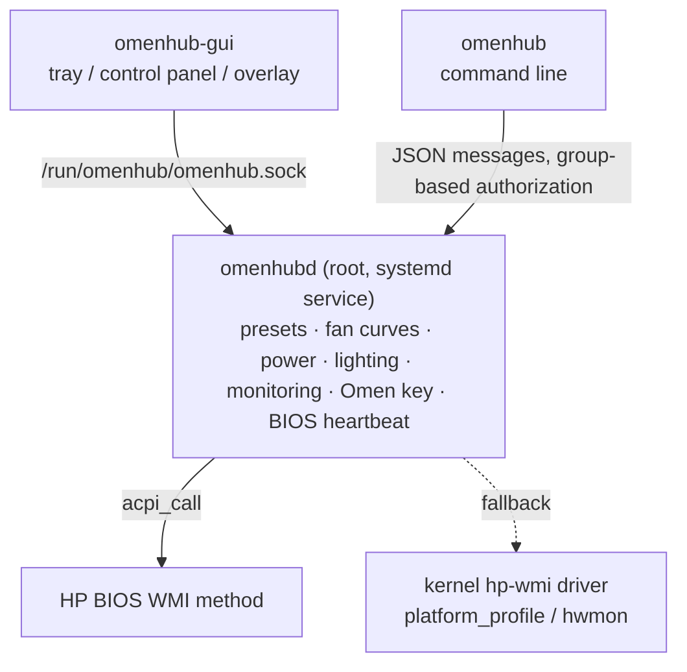

<div align="center">
  
  <h1 align="center">OmenSuperHub for Linux</h1>

  **Third-party control center for HP OMEN / Victus laptops — Linux port**

  [简体中文](README.md) | English
</div>

## About

This project ports [OmenSuperHub](https://github.com/breadeding/OmenSuperHub) (OSH, based on v2026.7.12.0) from Windows to Linux.
Without OMEN Gaming Hub, it provides fan control, power control, presets, Omen key customization, temperature / power
monitoring with an on-screen overlay, and keyboard lighting.
Like the original it talks to the hardware directly through HP's BIOS WMI interface (`hpqBIntM`), with no network access and no ads.

> [!WARNING]
> The port implements the BIOS commands exactly as the original source code and the Linux kernel hp-wmi driver do, and it is
> tested against simulated hardware, but it **has not yet been verified on many real machines**.
> As with the original, it targets OMEN 7 (2021) and later models; OMEN 6 and earlier are not supported, and using it on an
> unsupported model may fail to read data or have other consequences.
> When reporting problems please attach the output of `sudo omenhubd --probe`.

## Features

| Feature | Linux | Notes |
| --- | :---: | --- |
| Presets: Extreme Performance / GPU Priority / Light Use / Custom 1–3 | ✅ | Same rules as the original: built-in presets reset to defaults when switched to, custom presets are stored independently and can be renamed |
| Fan profiles: Silent / Cool / Custom curve + curve editor | ✅ | Curve files use the Windows format and can be copied over directly |
| Fan control: Auto / Max / fixed RPM, temperature smoothing, high-temperature auto-protect | ✅ | |
| Reverse dust removal (Clean Creek) | ✅ | Needs BIOS support |
| BIOS thermal mode | ✅ | Adds “Leave to system” to let power-profiles-daemon / TuneD manage it |
| CPU power (PL1+PL2), PPab condition (Tpp), IccMax, AC Load Line | ✅ | IccMax is hidden by default because HP's platform database is not available |
| GPU CTGP / PPAB / D-state | ✅ | |
| Graphics (MUX) mode: Hybrid / Discrete / Optimus / UMA | ✅ | Reboot required |
| GPU core / memory overclock, clock limit | ✅ | NVIDIA: NVML / nvidia-smi |
| Dynamic Boost | 🔄 | Mapped to the nvidia-powerd service on Linux |
| List and terminate processes using the dGPU | ✅ | |
| Hardware monitor, dynamic temperature tray icon, overlay | ✅ | Never wakes a sleeping dGPU; on Wayland the overlay runs through XWayland |
| Omen key: overlay / cycle presets / open an app / simulate a shortcut | ✅ | evdev + uinput, works on X11 and Wayland |
| Four-zone keyboard and light bar: static color, brightness, animations | ✅ | Both the basic and the Dojo protocol |
| Data localization (temperatures and RPM written to text files) | ✅ | Written to `/run/omenhub/*.txt` |
| Avoid power lock after OGH exits (BIOS heartbeat) | ✅ | The daemon talks to the BIOS every 30 seconds |
| Languages: Simplified Chinese / Traditional Chinese / English | ✅ | |
| Start on boot | ✅ | The daemon is started by systemd, the tray by XDG autostart |
| DB unlock, max frame rate, hot switch, GPU restart | ❌ | Depend on proprietary Windows driver interfaces |
| Per-key RGB keyboards | ❌ | Not controlled through the BIOS; use [OpenRGB](https://openrgb.org) |

## Architecture



- The Windows version is a single tray app running as administrator. On Linux the privileged part is a separate daemon,
  `omenhubd`, while the tray and the command line run as a regular user. Quitting the tray does not stop fan control.
- The daemon calls the BIOS method through the [acpi_call](https://github.com/nix-community/acpi_call) kernel module
  (sending exactly the same commands as the original). Without acpi_call it falls back to the in-kernel hp-wmi driver, which
  only covers part of the features: thermal mode, max fan / manual fan speed (depending on the kernel version), fan speed
  readings and graphics mode.
- Temperatures, power and clocks come from hwmon (coretemp / k10temp / zenpower), RAPL and cpufreq; NVIDIA data comes from
  nvidia-smi and AMD dGPU data from hwmon.

## Requirements

- An HP OMEN or Victus gaming laptop, OMEN 7 (2021) or later
- A Linux distribution with systemd, Python 3.8 or newer
- **The acpi_call kernel module** (strongly recommended, otherwise only part of the features work)
- For the tray: one of PyQt6, PySide6 or PyQt5
- For NVIDIA GPUs: the proprietary driver (provides nvidia-smi and NVML)
- Do not run other fan / performance tools that write to the same BIOS interface at the same time

## Installation

```bash
git clone https://github.com/ttwang2353666-cell/1.git omensuperhub-linux
cd omensuperhub-linux
sudo ./install.sh
```

The script:

1. installs the program to `/usr/local/lib/omenhub` and creates the `omenhubd`, `omenhub` and `omenhub-gui` commands
   (change the location with `--prefix`);
2. installs, enables and starts the `omenhubd` systemd service;
3. creates the `omenhub` group and adds the current user to it (takes effect after logging in again);
4. installs the application menu entry and icon, and checks for acpi_call and Qt.

> [!TIP]
> You can also give [docs/AI_INSTALL_PROMPT.md](docs/AI_INSTALL_PROMPT.md) (in Chinese) to an AI assistant that can run
> commands, such as Claude Code. It checks the model, installs the dependencies, and does the first start and the
> verification with a conservative configuration that only takes over the fans.

### Installing acpi_call

| Distribution | Command |
| --- | --- |
| Debian / Ubuntu / Linux Mint | `sudo apt install acpi-call-dkms` |
| Arch Linux / Manjaro | `sudo pacman -S acpi_call-dkms` (or the `acpi_call` package matching your kernel) |
| Fedora / openSUSE and others | build [nix-community/acpi_call](https://github.com/nix-community/acpi_call) from source, preferably with DKMS |

With Secure Boot enabled, third-party kernel modules must be signed before they can be loaded: enroll the MOK key when DKMS
asks for it, or disable Secure Boot in the BIOS. Afterwards run `sudo systemctl restart omenhubd`.

### Installing Qt (for the tray)

| Distribution | Command |
| --- | --- |
| Debian / Ubuntu | `sudo apt install python3-pyqt6` (`python3-pyqt5` on older releases) |
| Arch Linux | `sudo pacman -S python-pyqt6` |
| Fedora | `sudo dnf install python3-pyqt6` |
| openSUSE | `sudo zypper install python3-PyQt6` |

GNOME hides tray icons by default; install the
[AppIndicator and KStatusNotifierItem Support](https://extensions.gnome.org/extension/615/appindicator-support/) extension
(Ubuntu ships it already).

### Uninstalling

```bash
sudo ./uninstall.sh            # keeps the configuration in /var/lib/omenhub
sudo ./uninstall.sh --purge    # also removes the configuration and the omenhub group
```

## Usage

### Tray

Open **OmenSuperHub** from the application menu or run `omenhub-gui`.

- **Right-click the tray icon** for the same menu as on Windows: System Info, Presets, Fan Config, Fan Control, Performance,
  Lighting Control, HW Monitor, Overlay, Omen Key, Settings and Help;
- **Left-click the tray icon** to toggle the overlay;
- **Control Panel** (“Control Panel…” in the menu, or `omenhub-gui --panel`): one window with the Overview, Fans,
  Performance, Lighting, Monitor and Overlay, Omen Key and Settings tabs;
- Enable “Autostart” under Settings to start the tray when you log in.

### Command line

```bash
omenhub status -w              # live temperatures, power and fan speed
omenhub info                   # model, BIOS and supported features
omenhub preset                 # list presets; omenhub preset gpu switches to GPU Priority
omenhub fan auto               # automatic fan; also max or a fixed RPM such as omenhub fan 3000
omenhub fan-table silent       # fan profile: silent / cool / custom
omenhub curve export custom > my.txt
omenhub curve import custom my.txt --apply
omenhub thermal unleash        # BIOS thermal mode; system leaves it to the OS
omenhub cpu-power 90           # CPU power (PL1+PL2); none leaves it unset
omenhub gpu tgp on             # GPU CTGP; also ppab, dstate, core-oc, mem-oc, clock, ...
omenhub gfx                    # show the graphics mode; omenhub gfx hybrid switches (reboot required)
omenhub light color ff0000     # keyboard color; --zone 1-4 selects a zone, --lightbar targets the light bar
omenhub omen-key preset --presets extreme,gpu,light
```

See `omenhub --help` and `omenhub <command> --help` for everything; add `--json` for raw output in scripts.

## Configuration files

| Path | Contents |
| --- | --- |
| `/var/lib/omenhub/config.json` | Daemon configuration: current preset, preset fields, global settings, platform parameters (replaces the Windows registry keys) |
| `/var/lib/omenhub/silent.txt`, `cool.txt`, `custom.txt` | Fan curves |
| `~/.config/omenhub/gui.json` | Per-user interface settings: language, icon, overlay, the app opened by the Omen key |
| `~/.config/omenhub/custom.png` | Custom tray icon |

- Fan curve files use the Windows format (`Fan_Table_CPU_Temperature_List=…`, the old CSV format is accepted too), so you can
  copy your Windows txt files over or import them with “Load” in the curve editor.
- The Windows version reads per-model parameters from HP's platform database, which is not available on Linux. Set them in
  the `platform` section of `config.json` and run `sudo systemctl restart omenhubd`:
  - `pl1_performance` / `pl1_default`: CPU power used by the presets. They cannot be detected and default to the original's
    fallback values of 160 W / 55 W. Like the original, the first start applies the Extreme Performance preset, which sets
    CPU PL1/PL2 to `pl1_performance`, so adjust it for your model
  - `max_fan_rpm` (read from the BIOS fan table by default), `iccmax_support` (show the IccMax option),
    `clean_creek_level` / `clean_creek_seconds` (dust removal speed and duration), `backend` (`auto` / `acpi_call` / `hp-wmi`)

## Permissions

- The daemon runs as root. Its socket is open to all local users, but **only root and members of the `omenhub`, `wheel`,
  `sudo` or `admin` groups can change settings**; everybody else can only read the status. Adjust the list with
  `platform.allowed_groups` in `config.json`.
- The command opened by the Omen key's “Open App” action is stored in the user's own settings and run by that user's tray;
  the daemon never launches applications as root.

## FAQ

### The tray menu says “No BIOS interface available” or “Using the limited hp-wmi interface”

acpi_call is not loaded. Check with `lsmod | grep acpi_call`, install it as described above and restart the service. With
Secure Boot enabled the module must be signed.

### The thermal mode gets changed back / conflicts with power-profiles-daemon or TuneD

The original OSH pins the BIOS to its unleashed mode and limits power with CPU power, PPab and the other options. The port
does the same by default and also sets the kernel `platform_profile` to performance. If you prefer the desktop power modes
(power-profiles-daemon / TuneD), choose “Leave to system” under Performance → BIOS Thermal Mode (`omenhub thermal system`).

### The fans do not go below 2000 RPM

Some models need “Fan Always On” to be disabled in the BIOS setup.

### The overlay on Wayland

Wayland does not let applications position their windows or keep them on top, so the tray shows the overlay through XWayland
(XWayland must be installed). Set `OMENHUB_NATIVE_WAYLAND=1` to use native Wayland instead.

### The dGPU is shown as “PoweredOff” in hybrid mode

While the dGPU sleeps (D3) it is not polled, so it is not woken up; polling also pauses while it is idle so it can go to
sleep. Overclocking and the clock limit are re-applied automatically when it wakes up.

### The Omen key does nothing

The kernel hp-wmi driver reports the Omen key as `XF86Launch2` (KEY_PROG2). With “Default” OSH ignores it and you can bind
it in your desktop's keyboard settings; any other action is handled by the daemon.

### Logs and bug reports

```bash
journalctl -u omenhubd -b      # daemon log
sudo omenhubd --probe          # model, BIOS and feature detection (please attach to bug reports)
```

## Development and testing

Everything runs on any Linux machine with simulated hardware (no root needed):

```bash
python3 -m omenhub.daemon --mock --config /tmp/omenhub-demo/config.json --socket /tmp/omenhub-demo/omenhub.sock
python3 -m omenhub --socket /tmp/omenhub-demo/omenhub.sock status
python3 -m omenhub.gui --socket /tmp/omenhub-demo/omenhub.sock --panel
```

Running the tests:

```bash
python3 -m pip install pytest
python3 -m pytest
```

Code layout:

| Module | Contents | Windows counterpart |
| --- | --- | --- |
| `omenhub/wmi.py` | BIOS calls: acpi_call, hp-wmi fallback, simulated BIOS | WMI calls in `OmenHardware.cs` |
| `omenhub/hardware.py` | BIOS commands: fans, power, GPU, MUX, lighting, model validation | `OmenHardware.cs`, `OmenLighting` |
| `omenhub/daemon.py` | Daemon: presets, fan loop, heartbeat, power events, Omen key | `Program.cs`, `Program.Config.cs`, `Program.OmenKey.cs` |
| `omenhub/fancurve.py` | Fan curve files and interpolation | `FanCurveProfile.cs` |
| `omenhub/sensors.py`, `omenhub/nvidia.py` | Sensors, NVIDIA control | LibreHardwareMonitor, NVAPI |
| `omenhub/gui/` | Tray menu, control panel, curve editor, overlay, help | `Program.Menu.cs`, `FanCurveForm.cs`, `FloatingForm.cs`, `HelpForm.cs` |
| `omenhub/cli.py` | Command line tool | — |

## Credits

- [OmenSuperHub](https://github.com/breadeding/OmenSuperHub) by **@breadeding**: the original this project ports; the
  feature design and BIOS commands all come from it
- [OmenMon](https://github.com/OmenMon/OmenMon) and [OmenHwCtl](https://github.com/GeographicCone/OmenHwCtl) by
  **@GeographicCone**: the main inspiration of the original
- The Linux kernel [hp-wmi](https://github.com/torvalds/linux/blob/master/drivers/platform/x86/hp/hp-wmi.c) driver and the
  [acpi_call](https://github.com/nix-community/acpi_call) module

## License

[GPL-3.0](LICENSE), the same as the original.

## Disclaimer

This program is not affiliated with HP or OMEN; brand names are for reference only. It interacts with the hardware directly
and may be dangerous or destructive. You use it entirely at your own risk.
