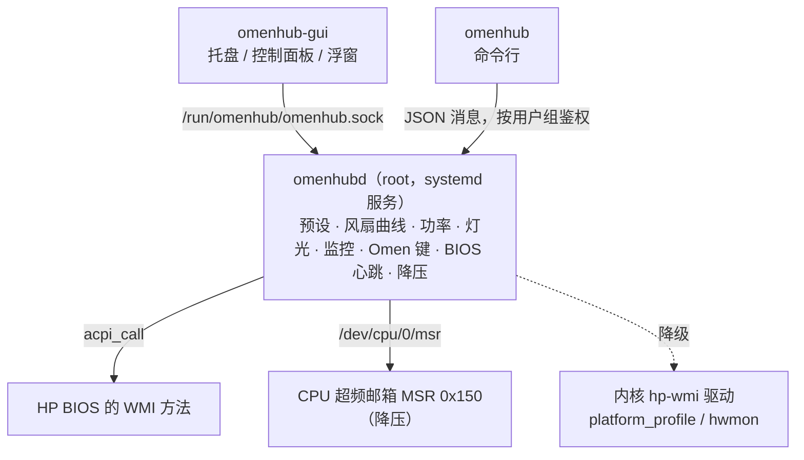

<div align="center">
  
  <h1 align="center">OmenSuperHub for Linux</h1>

  **惠普暗影精灵 / 光影精灵笔记本第三方控制台 —— Linux 移植版**

  [](https://github.com/ttwang2353666-cell/1/actions/workflows/ci.yml)
  [](https://github.com/ttwang2353666-cell/1/releases)
  [](LICENSE)
  [](https://reuse.software)

  简体中文 | [English](README.EN.md)
</div>

## 简介

本项目把 Windows 下的 [OmenSuperHub](https://github.com/breadeding/OmenSuperHub)（OSH，基于 v2026.7.12.0）移植到 Linux，在不安装 OMEN Gaming Hub 的情况下提供风扇控制、功率控制、预设切换、Omen 键自定义、温度/功率监控与浮窗、键盘灯光等功能。与原版一样，程序通过 HP BIOS 的 WMI 接口（`hpqBIntM`）直接与硬件交互，不联网、没有广告。

> [!WARNING]
> 移植版严格按照原版源码与 Linux 内核 hp-wmi 驱动实现 BIOS 命令，并在模拟硬件上完成了测试，但**尚未在大量真机上验证**。
> 与原版相同：主要面向暗影精灵 7 及以后的机型，不支持暗影精灵 6 及以前的机型；在不支持的机型上使用可能出现无法读取数据或其他后果。
> 遇到问题请附上 `sudo omenhubd --probe` 的输出反馈。

## 功能对照

| 功能 | Linux 版 | 说明 |
| --- | :---: | --- |
| 预设：极致性能 / GPU 优先 / 轻度使用 / 自定义 1~3 | ✅ | 规则与原版一致：内置预设切换时恢复默认值，自定义预设各自独立保存，可重命名 |
| 风扇配置：安静 / 降温 / 自定义曲线 + 曲线编辑器 | ✅ | 曲线文件格式与 Windows 版相同，可直接复制使用 |
| 风扇控制：自动 / 最大 / 固定转速、温度平滑、高温自动保护 | ✅ | |
| 反转除尘（Clean Creek） | ✅ | 需要 BIOS 支持 |
| BIOS 性能模式 | ✅ | 新增“不接管”，可交给 power-profiles-daemon / TuneD 管理 |
| CPU 功率（PL1+PL2）、PPab 条件（Tpp）、IccMax、AC Load Line | ✅ | IccMax 缺少 HP 平台数据库，默认隐藏 |
| CPU 降压（Intel 核心与缓存电压偏移，即 ThrottleStop 的降压功能） | ✅ | Linux 版新增。需要 BIOS 没有锁定降压、内核没有开启 lockdown；异常关机后自动暂停 |
| 显卡 CTGP / PPAB / D 状态 | ✅ | |
| 图形模式（独显直连 MUX：混合 / 独显 / Optimus / 集显） | ✅ | 需要重启 |
| GPU 核心 / 显存超频、频率限制 | ✅ | NVIDIA：NVML / nvidia-smi |
| Dynamic Boost | 🔄 | 对应 Linux 下的 nvidia-powerd 服务开关 |
| 独显占用进程查看与结束 | ✅ | |
| 硬件监控、托盘动态温度图标、监控浮窗 | ✅ | 独显休眠时不唤醒它；Wayland 下浮窗经 XWayland 显示 |
| Omen 键：浮窗 / 切换预设 / 打开应用 / 模拟快捷键 | ✅ | evdev 监听 + uinput 模拟，X11 与 Wayland 均可用 |
| 四分区键盘与灯条灯光：静态颜色、亮度、动画 | ✅ | 支持 basic 与 Dojo 两种协议 |
| 数据本地化（温度与转速写入文本文件） | ✅ | 写入 `/run/omenhub/*.txt` |
| 防止退出 OGH 后锁功耗（BIOS 心跳） | ✅ | 后台服务每 30 秒与 BIOS 通信 |
| 三种界面语言：简体中文 / 繁体中文 / English | ✅ | |
| 开机自启 | ✅ | 服务由 systemd 启动，托盘程序使用 XDG 自启动 |
| DB 解锁、最大帧率、热切换、重启显卡 | ❌ | 依赖 Windows 专有驱动接口 |
| 单键 RGB 键盘 | ❌ | 不经过 BIOS 控制，Linux 下请使用 [OpenRGB](https://openrgb.org) |

## 架构



- Windows 版是一个以管理员身份运行的托盘程序；Linux 版把需要 root 的部分拆成后台服务 `omenhubd`，托盘程序与命令行以普通用户运行。退出托盘程序不会停止风扇控制。
- 服务优先通过 [acpi_call](https://github.com/nix-community/acpi_call) 内核模块调用 BIOS 方法（与原版发送的命令完全一致）；没有 acpi_call 时退回内核自带的 hp-wmi 驱动接口，只能使用性能模式、最大风扇 / 手动转速（取决于内核版本）、风扇转速读取和显卡模式等部分功能。
- 温度、功率与频率来自 Linux 的 hwmon（coretemp / k10temp / zenpower）、RAPL 与 cpufreq；NVIDIA 显卡数据来自 nvidia-smi，AMD 独显来自 hwmon。

## 系统要求

- 惠普暗影精灵（OMEN）/ 光影精灵（Victus）游戏本，暗影精灵 7 及以后的机型
- 使用 systemd 的 Linux 发行版，Python 3.8 或更高版本
- **acpi_call 内核模块**（强烈推荐，否则只有部分功能）
- 托盘程序：PyQt6、PySide6 或 PyQt5 之一
- NVIDIA 显卡：官方驱动（提供 nvidia-smi 与 NVML）
- 不要同时运行其他会写入同一 BIOS 接口的风扇 / 性能控制工具

## 安装

```bash
git clone https://github.com/ttwang2353666-cell/1.git omensuperhub-linux
cd omensuperhub-linux
sudo ./install.sh
```

也可以从 [Releases](https://github.com/ttwang2353666-cell/1/releases) 下载源码包，解压后在目录中运行 `sudo ./install.sh`。

安装脚本会：

1. 把程序安装到 `/usr/local/lib/omenhub`，并创建 `omenhubd`、`omenhub`、`omenhub-gui` 三个命令（`--prefix` 可修改安装位置）；
2. 安装并启动 systemd 服务 `omenhubd`，开机自动运行；
3. 创建 `omenhub` 用户组并把当前用户加入其中（重新登录后生效）；
4. 安装应用菜单项与图标，检查 acpi_call 与 Qt 是否可用并给出提示。

> [!TIP]
> 也可以把 [docs/AI_INSTALL_PROMPT.md](docs/AI_INSTALL_PROMPT.md) 交给能执行命令的 AI 助手（如 Claude Code），让它检查机型、安装依赖，并以只接管风扇的保守配置完成首次启动和验证。

### 安装 acpi_call

| 发行版 | 命令 |
| --- | --- |
| Debian / Ubuntu / Linux Mint | `sudo apt install acpi-call-dkms` |
| Arch Linux / Manjaro | `sudo pacman -S acpi_call-dkms`（或与内核对应的 `acpi_call` 包） |
| Fedora / openSUSE 等 | 从 [nix-community/acpi_call](https://github.com/nix-community/acpi_call) 编译安装，推荐配合 DKMS |

开启了安全启动（Secure Boot）时，第三方内核模块需要签名后才能加载：按 DKMS 安装时的提示登记 MOK 密钥，或在 BIOS 中关闭安全启动。安装模块后执行 `sudo systemctl restart omenhubd` 即可。

### 安装 Qt（托盘程序）

| 发行版 | 命令 |
| --- | --- |
| Debian / Ubuntu | `sudo apt install python3-pyqt6`（较旧的系统用 `python3-pyqt5`） |
| Arch Linux | `sudo pacman -S python-pyqt6` |
| Fedora | `sudo dnf install python3-pyqt6` |
| openSUSE | `sudo zypper install python3-PyQt6` |

GNOME 默认不显示托盘图标，需要安装 [AppIndicator and KStatusNotifierItem Support](https://extensions.gnome.org/extension/615/appindicator-support/) 扩展（Ubuntu 已自带）。

### 卸载

```bash
sudo ./uninstall.sh            # 保留 /var/lib/omenhub 中的配置
sudo ./uninstall.sh --purge    # 同时删除配置与 omenhub 用户组
```

## 使用

### 托盘程序

在应用菜单中打开 **OmenSuperHub**，或运行 `omenhub-gui`。

- **右键托盘图标**：与 Windows 版相同的菜单——本机信息、预设、风扇配置、风扇控制、性能控制、灯光控制、硬件监控、浮窗显示、Omen 键、其他设置、帮助；
- **左键托盘图标**：开关监控浮窗；
- **控制面板**（菜单中的“控制面板…”或 `omenhub-gui --panel`）：在一个窗口中集中调整概览、风扇、性能、灯光、监控与浮窗、Omen 键和设置；
- 在“其他设置”中开启“开机自启”后，登录桌面时自动启动托盘程序。

### 命令行

```bash
omenhub status -w              # 实时查看温度、功率与转速
omenhub info                   # 机型、BIOS 与支持的功能
omenhub preset                 # 列出预设；omenhub preset gpu 切换到 GPU 优先
omenhub fan auto               # 自动风扇；也可以是 max 或固定转速，如 omenhub fan 3000
omenhub fan-table silent       # 风扇配置：silent / cool / custom
omenhub curve export custom > my.txt
omenhub curve import custom my.txt --apply
omenhub thermal unleash        # BIOS 性能模式；system 表示交给系统管理
omenhub cpu-power 90           # CPU 功率（PL1+PL2），none 表示不设置
omenhub undervolt -80          # CPU 降压 80mV（核心与缓存）；none 恢复开机时的值，--read 读取当前偏移
omenhub gpu tgp on             # 显卡 CTGP；另有 ppab、dstate、core-oc、mem-oc、clock 等
omenhub gfx                    # 查看图形模式；omenhub gfx hybrid 切换（需重启）
omenhub light color ff0000     # 键盘颜色；--zone 1~4 指定分区，--lightbar 控制灯条
omenhub omen-key preset --presets extreme,gpu,light
```

完整命令见 `omenhub --help` 与 `omenhub <命令> --help`；加 `--json` 可输出原始数据，便于脚本使用。

## 配置文件

| 路径 | 内容 |
| --- | --- |
| `/var/lib/omenhub/config.json` | 后台服务配置：当前预设、各预设字段、全局设置、平台参数（替代 Windows 版的注册表） |
| `/var/lib/omenhub/silent.txt`、`cool.txt`、`custom.txt` | 风扇曲线 |
| `~/.config/omenhub/gui.json` | 每个用户自己的界面设置：语言、图标、浮窗、Omen 键要打开的应用 |
| `~/.config/omenhub/custom.png` | 自定义托盘图标 |

- 风扇曲线文件与 Windows 版格式相同（`Fan_Table_CPU_Temperature_List=…`，也兼容旧的 CSV 格式），可以把 Windows 下的 txt 文件直接复制过来，或用曲线编辑器的“加载”导入。
- Windows 版从 HP 平台数据库读取各机型的参数，Linux 下读不到，可以在 `config.json` 的 `platform` 中手动填写，修改后执行 `sudo systemctl restart omenhubd`：
  - `pl1_performance` / `pl1_default`：预设使用的 CPU 功率。无法自动探测，默认使用与原版相同的后备值 160W / 55W。首次启动时会像原版一样应用“极致性能”预设，把 CPU PL1/PL2 设为 `pl1_performance`，建议按机型调整
  - `max_fan_rpm`（最高转速，默认读取 BIOS 风扇表）、`iccmax_support`（显示 IccMax 选项）、`clean_creek_level` / `clean_creek_seconds`（反转除尘转速与时长）、`backend`（`auto` / `acpi_call` / `hp-wmi`）

## 权限

- 后台服务以 root 运行，套接字对所有本地用户开放，但**只有 root 和 `omenhub`、`wheel`、`sudo`、`admin` 组的成员可以修改设置**，其他用户只能查看状态。可以在 `config.json` 的 `platform.allowed_groups` 中调整。
- Omen 键“打开应用”的命令保存在用户自己的配置中，由该用户的托盘程序执行，后台服务不会以 root 身份运行任何应用。

## 常见问题

### 托盘菜单提示“未找到可用的 BIOS 接口”或“当前使用 hp-wmi 降级接口”

说明 acpi_call 没有加载。执行 `lsmod | grep acpi_call` 检查；按上文安装后重启服务。开启安全启动时需要为模块签名。

### 性能模式被系统改回去 / 与 power-profiles-daemon、TuneD 冲突

原版 OSH 固定把 BIOS 设为“释放全部性能”模式，再通过 CPU 功率、PPab 等选项控制功耗；移植版默认与原版一致，并同步内核的 `platform_profile` 为 performance。如果希望由桌面的电源模式（power-profiles-daemon / TuneD）控制，请在“性能控制 → BIOS性能模式”中选择“不接管”（`omenhub thermal system`）。

### 风扇无法低于 2000 转

部分机型需要在 BIOS 设置中关闭“风扇始终启动（Fan Always On）”。

### Wayland 下的浮窗

Wayland 不允许程序自行定位窗口和置顶，托盘程序会自动通过 XWayland 显示浮窗（需要安装 XWayland）。如需原生 Wayland，可设置环境变量 `OMENHUB_NATIVE_WAYLAND=1`。

### 混合模式下独显显示“节能”

独显处于休眠（D3）时程序不会读取它的数据，避免把它唤醒；独显空闲时也会暂停读取，让它有机会进入休眠。超频与频率限制会在独显唤醒后自动重新应用。

### Omen 键没有反应

Omen 键由内核 hp-wmi 驱动上报为 `XF86Launch2`（KEY_PROG2）。“默认”时 OSH 不处理，可以在桌面环境的快捷键设置中自行绑定；选择其他动作后由后台服务处理。

### CPU 降压（ThrottleStop 的降压功能）怎么用

在托盘菜单“性能控制 → CPU降压”、控制面板的“性能”页，或用 `omenhub undervolt` 设置。核心与缓存使用相同的偏移（12 代起两者共用电压）。

- **前提**：Intel 处理器；内核没有开启 lockdown（`cat /sys/kernel/security/lockdown` 显示 `[none]`，开启安全启动时通常是 integrity）；BIOS 没有锁定降压。可以先用 `omenhub undervolt -10` 测试，提示“CPU 拒绝了电压偏移”就说明被 BIOS 锁定了，Windows 下的 ThrottleStop 同样无法降压。
- **安全机制**：没有设置降压时程序不会访问 MSR；“不设置”恢复本次开机时 CPU 上原有的值（BIOS 或其他工具可能已经设置过偏移）；降压只在后台服务运行期间生效，停止服务时恢复原值；如果应用降压后系统没有正常关机（死机、强制关机），下次开机会暂停自动降压，在菜单中重新选择数值才会恢复。
- **稳定性测试**：降压过度会导致死机或程序出错。建议从 -50mV 开始，每次加大 10~20mV，并运行压力测试（例如 `stress-ng --cpu 0 --timeout 10m`），找到稳定值后再回退一些作为余量。
- 内核日志里会出现 “Write to unrecognized MSR 0x150” 警告，这是内核对写入 MSR 的正常提示；可在内核参数中加入 `msr.allow_writes=on` 关闭。
- 不要同时使用 intel-undervolt、throttled 等其他降压工具，它们会互相覆盖设置。

### 查看日志与反馈问题

```bash
journalctl -u omenhubd -b      # 服务日志
sudo omenhubd --probe          # 机型、BIOS 与各项功能的探测结果（反馈问题时请附上）
```

## 开发与测试

可以在任何 Linux 机器上用模拟硬件运行（不需要 root）：

```bash
python3 -m omenhub.daemon --mock --config /tmp/omenhub-demo/config.json --socket /tmp/omenhub-demo/omenhub.sock
python3 -m omenhub --socket /tmp/omenhub-demo/omenhub.sock status
python3 -m omenhub.gui --socket /tmp/omenhub-demo/omenhub.sock --panel
```

运行测试：

```bash
python3 -m pip install pytest
python3 -m pytest
```

代码结构：

| 模块 | 内容 | 对应的 Windows 版代码 |
| --- | --- | --- |
| `omenhub/wmi.py` | BIOS 调用：acpi_call、hp-wmi 降级、模拟 BIOS | `OmenHardware.cs` 中的 WMI 调用 |
| `omenhub/hardware.py` | BIOS 命令：风扇、功率、显卡、MUX、灯光、机型校验 | `OmenHardware.cs`、`OmenLighting` |
| `omenhub/daemon.py` | 后台服务：预设、风扇循环、心跳、电源事件、Omen 键 | `Program.cs`、`Program.Config.cs`、`Program.OmenKey.cs` |
| `omenhub/fancurve.py` | 风扇曲线文件与插值 | `FanCurveProfile.cs` |
| `omenhub/sensors.py`、`omenhub/nvidia.py` | 传感器、NVIDIA 控制 | LibreHardwareMonitor、NVAPI |
| `omenhub/gui/` | 托盘菜单、控制面板、曲线编辑器、浮窗、帮助 | `Program.Menu.cs`、`FanCurveForm.cs`、`FloatingForm.cs`、`HelpForm.cs` |
| `omenhub/undervolt.py` | CPU 降压：MSR 0x150 超频邮箱 | 原版没有，对应 ThrottleStop 的 FIVR 降压 |
| `omenhub/cli.py` | 命令行工具 | —— |

## 参与贡献

欢迎反馈问题和提交代码，见 [CONTRIBUTING.md](CONTRIBUTING.md)；各版本的变化见 [CHANGELOG.md](CHANGELOG.md)。

## 贡献者与致谢

- 维护者：[ttwang2353666-cell](https://github.com/ttwang2353666-cell)
- Linux 移植版：由 Claude（Anthropic 的 AI 助手）在维护者的指导下编写
- 原版：[OmenSuperHub](https://github.com/breadeding/OmenSuperHub)，作者 breaded（[@breadeding](https://github.com/breadeding)），本项目的功能设计与 BIOS 命令均来自它
- 参考的项目：[OmenMon](https://github.com/OmenMon/OmenMon) 与 [OmenHwCtl](https://github.com/GeographicCone/OmenHwCtl)（GeographicCone，原版的主要灵感来源）、Linux 内核 [hp-wmi](https://github.com/torvalds/linux/blob/master/drivers/platform/x86/hp/hp-wmi.c) 与 WMI 驱动、[acpi_call](https://github.com/nix-community/acpi_call)（Michal Kottman）、ThrottleStop（Kevin Glynn）、[intel-undervolt](https://github.com/kitsunyan/intel-undervolt)（kitsunyan）与 [undervolt](https://github.com/georgewhewell/undervolt)（George Whewell）

完整名单以及从各项目借鉴的内容见 [CONTRIBUTORS.md](CONTRIBUTORS.md)。

## 许可证

本项目是 [OmenSuperHub](https://github.com/breadeding/OmenSuperHub)（Copyright © breaded）的修改版本：2026 年 10 月移植到 Linux 并用 Python 重写。与原版相同，以 [GNU 通用公共许可证第 3 版](LICENSE)（GPL-3.0-only）发布。

Copyright © 2026 OmenSuperHub for Linux contributors（见 [CONTRIBUTORS.md](CONTRIBUTORS.md)）

> This program is free software: you can redistribute it and/or modify it under the terms of the GNU General Public
> License as published by the Free Software Foundation, version 3.
>
> This program is distributed in the hope that it will be useful, but WITHOUT ANY WARRANTY; without even the implied
> warranty of MERCHANTABILITY or FITNESS FOR A PARTICULAR PURPOSE. See the GNU General Public License for more details.

每个文件的版权与许可证信息写在文件头的 SPDX 标注中（Markdown 等文件见 [REUSE.toml](REUSE.toml)），符合 [REUSE](https://reuse.software) 规范。

## 免责声明

本程序不属于 HP 或 OMEN，品牌名称仅供参考。本程序直接与硬件交互，可能具有潜在危险或破坏性，使用者自行承担使用本程序的所有后果。
